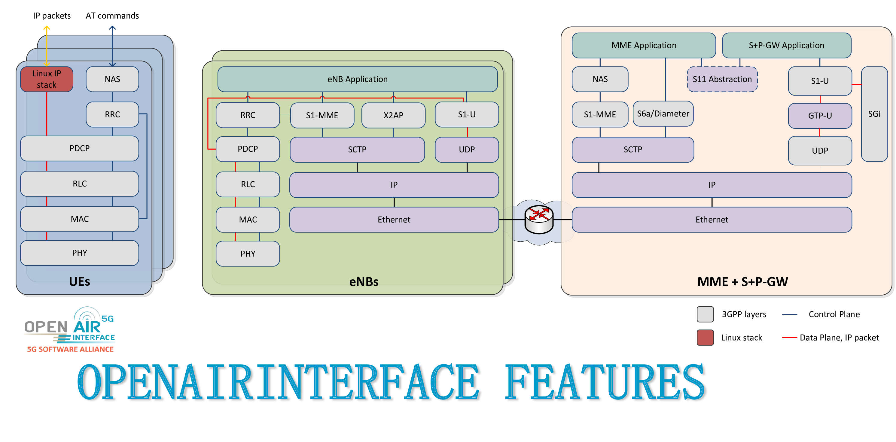

<!-- SPDX-License-Identifier: CC-BY-4.0 -->

# Feature Set

**Table of Contents**

[[_TOC_]]

## Functional Split Architecture

-  RCC: Radio-Cloud Center
-  RAU: Radio-Access Unit
-  RRU: Remote Radio-Unit
-  IF4.5 / IF5 : similar to IEEE P1914.1
-  FAPI (IF2)  : specified by Small Cell Forum (open-nFAPI implementation)
-  IF1         : F1 in 3GPP Release 15

## OpenAirInterface Block Diagram

## OpenAirInterface 5G-NR Feature Set

### General Parameters

The following features are valid for the gNB and the 5G-NR UE.

*  Static TDD
   - Multi TDD pattern supported refer [TDD Configuration](MAC/mac-usage.md)
*  Static FDD
*  Normal CP
*  Subcarrier spacings: 15 and 30kHz (FR1), 120kHz (FR2)
*  Bandwidths: 5-100MHz (FR1), 100 and 200MHz (FR2)
*  Intermediate downlink and uplink frequencies to interface with IF equipment
*  Procedures for 4-layer DL and 2-layer UL SU-MIMO
*  Slot format: 14 OFDM symbols in UL or DL
*  Highly efficient 3GPP compliant LDPC encoder and decoder (BG1 and BG2 supported)
*  Highly efficient 3GPP compliant polar encoder and decoder
*  Encoder and decoder for short blocks
*  Support for UL transform precoding (SC-FDMA)
*  LDPC offload (see [LDPC offload setup](LDPC_OFFLOAD_SETUP.md)):
   - Intel ACCs, Amd/Xilinx T2 via O-RAN AAL/DPDK BBDEV
   - NVIDIA GPUs via CUDA, AMD GPUs via HIP
   - OpenRadioSystems Aurora (decoding only)

These modes of operation are supported:

* "phy-test" mode (gNB, nrUE):
  - gNB and nrUE have hardcoded RNTI and radio configuration
  - gNB schedules the nrUE all the time, even if no UE connected
  - can be used for performance evaluation
* "noS1" mode (DL and UL, gNB, nrUE):
  - Connection setup stops after RA; RRC configuration is exchanged through
    files
  - Creates TUN interface to SDAP to inject and receive user-place traffic
  - No connection to the core network
* Standalone (SA) mode (gNB, nrUE):
  - UE can register with the 5G Core Network through the gNB, establish a PDU
    Session and exchange user-plane traffic
  - Reestablishment supported
* Non-standalone (NSA) mode (gNB):
  - UE can use the gNB for user plane traffic while connected to the 4G eNB
  - is unstable (only one UE connection)

### gNB PHY

*  15kHz and 30kHz SCS for FR1 and 120kHz SCS for FR2
*  Generation of NR-PSS/NR-SSS
*  NR-PBCH supports multiple SSBs and flexible periodicity
*  Generation of NR-PDCCH (including generation of DCI, polar encoding, scrambling, modulation, RB mapping, etc)
   - common search space
   - user-specific search space
   - DCI formats: 00, 10, 01 and 11
*  Generation of NR-PDSCH (including Segmentation, LDPC encoding, rate matching, scrambling, modulation, RB mapping, etc).
   - PDSCH mapping type A and B
   - DMRS configuration type 1 and 2
   - Single and multiple DMRS symbols
   - PTRS support
   - Support for up to 4 TX antennas
   - Support for up to 4 layers
   - Support for 256 QAM
*  NR-CSIRS Generation of sequence at PHY
*  NR-PUSCH (including Segmentation, LDPC encoding, rate matching, scrambling, modulation, RB mapping, etc).
   - PUSCH mapping type A and B
   - DMRS configuration type 1 and 2
   - Single and multiple DMRS symbols
   - PTRS support
   - Support for up to 4 RX antennas
   - Support for up to 2 layers
   - Support for 256 QAM
*  NR-PUCCH
   - Format 0 (2 bits, for ACK/NACK and SR)
   - Format 2 (mainly for CSI feedback, SR)
*  NR-SRS
    - SRS signal reception (periodic and aperiodic)
    - Channel estimation (with T tracer real time monitoring)
    - Power noise estimation
*  NR-PRS
    - Rel16 Positioning reference signal(PRS) generation and modulation
    - Multiple PRS resources, one per beam is supported in FR2 TDD mode
    - FR1 and FR2 support with config file
*  NR-PRACH
   - Formats 0,1,2,3, A1-A3, B1-B3
*  Highly efficient 3GPP compliant LDPC encoder and decoder (BG1 and BG2 are supported)
*  Highly efficient 3GPP compliant polar encoder and decoder
*  Encoder and decoder for short block

### gNB MAC

- MAC -> PHY configuration using NR FAPI P5 interface
- MAC <-> PHY data interface using FAPI P7 interface for DL_TTI.request,
  UL_TTI.request, UL_DCI.request, TX_data.request, RX_Data.indication,
  CRC.indication, UCI.indication, SRS.indication
- Generation of and scheduler procedures for MIB/SIB1
- Scheduler procedures for RA
    - 4-Step RA
        - Contention Free RA procedure
        - Contention Based RA procedure
            - Msg3 can transfer uplink CCCH, DTCH or DCCH messages
            - CBRA can be performed using MAC CE for C-RNTI
            - Is not possible to use 2-Step RA and 4-Step RA at the same time
    - 2-Step RA
        - Contention Based RA procedure
            - MsgA can transfer uplink CCCH, DTCH or DCCH messages
            - CBRA can be performed using MAC CE for C-RNTI
            - Is not possible to use 2-Step RA and 4-Step RA at the same time
            - Fallback not supported
- Scheduler procedures for CSI-RS
- MAC downlink scheduler
  - phy-test scheduler (fixed allocation and usable also without UE)
  - regular scheduler with dynamic proportionally-fair allocation
  - MCS adaptation from HARQ BLER or SSB-SINR report
- MAC header generation (including timing advance)
- ACK/NACK handling and HARQ procedures for downlink
- MAC uplink scheduler
  - phy-test scheduler (fixed allocation)
  - regular scheduler with dynamic proportionally-fair allocation
  - HARQ procedures for uplink
  - MCS adaption from HARQ BLER or PUSCH SINR
- Scheduler procedures for SRS reception
  - Periodic and aperiodic SRS reception
  - Channel rank computation up to 2x2 scenario
  - TPMI computation based on SRS up 4 antenna ports and 2 layers
- MAC procedures to handle CSI measurement report
  - evalution of RSRP report
  - evaluation of CQI report
- MAC scheduling of SR reception
- Paging (PCCH/P-RNTI)
  - CN paging records queued
  - PF/PO dequeue from SIB1 PCCH-Config
  - PCCH encoded at the UE's PO
  - Type2 common search-space based P-RNTI PDCCH + PDSCH scheduling for PCCH
- Intra-frequency handover
- Inter-frequency handover
    - Measurement gaps are automatically computed at the DU if the CU has neighbor information and the configured
      neighbors include cells operating on different frequencies
    - DUs must be synchronized with each other for the measurements to be properly performed
- NR-DC (see [NR-DC](nr-dc.md))
- Initial support for RedCap
  - RedCap SIB1 v17 IEs supported
  - Coexistence of RedCap and Normal UEs
  - Handling of RedCap capability for small PDCP/RLC SN size
- Scheduling of other SIBs (2, 3, 4, 19)
- NTN
  - Support downlinkHARQ-FeedbackDisabled-r17
  - Support for 32 PDSCH and PUSCH HARQ processes per UE
  - Consider ntn-Config-r17.cellSpecificKoffset-r17 in scheduling
  - Function-based interface for ntn-Config-r17 updates (used by NTN-LEO RFsimulator)

### gNB RLC

- Send/Receive operations according to 38.322 Rel.16
  - Segmentation and reassembly procedures
  - RLC Acknowledged mode supporting PDU retransmissions
  - RLC Unacknowledged mode
  - DRBs and SRBs establishment/handling and association with RLC entities
  - Timers implementation
  - Interfaces with PDCP, MAC
  - Interfaces with gtp-u (data Tx/Rx over F1-U at the DU)

### gNB PDCP

- Send/Receive operations according to 38.323 Rel.16
  - Integrity protection and ciphering procedures
  - Sequence number management, SDU dicard and in-order delivery
  - Radio bearer establishment/handling and association with PDCP entities
  - Interfaces with RRC, RLC
  - Interfaces with gtp-u (data Tx/Rx over N3 and F1-U interfaces)

### gNB SDAP

- Send/Receive operations according to 37.324 Rel.15
  - Establishment/Handling of SDAP entities.
  - Transfer of User Plane Data
  - Mapping between a QoS flow and a DRB for both DL and UL
  - Multiple QoS flows per DRB, multiple DRBs per PDU session
  - Marking QoS flow ID in both DL and UL packets
  - Reflective QoS flow to DRB mapping for UL SDAP data PDUs

### gNB RRC

- NR RRC (38.331) Rel 17 messages using new [asn1c](https://github.com/mouse07410/asn1c)
- LTE RRC (36.331) also updated to Rel 15
- Generation of system information (SIB2, SIB3, SIB4)
- RRC can configure PDCP and SDAP (through E1), and RLC and MAC (through F1)
- Interface with GTP-U (tunnel creation/handling for S1-U (NSA), N3 (SA), F1 interfaces)
- Integration of RRC messages and procedures supporting UE 5G SA connection
  - RRCSetupRequest/RRCSetup/RRCSetupComplete
  - RRC Uplink/Downlink Information transfer carrying NAS messages transparently
  - RRC Reconfiguration/Reconfiguration complete
  - RRC Reestablishment/Reestablishment complete
  - Support for MasterCellGroup configuration (from DU)
  - Interface with NGAP for the interactions with the AMF
  - Interface with F1AP for CU/DU split deployment option
  - Interface with E1AP for CU-CP/CU-CP split deployment option
  - Periodic RRC measurements of serving/neighbour cells and A2/A3 event
    handling
- RRC Mobility Management Procedures:
  - Inter-DU Handover (F1-based handover within same CU)
  - Inter-gNB Handover (N2-based handover between different gNBs)
  - Handover Preparation Information generation and processing
  - Handover Command generation and processing
  - PDCP Status transfer procedures
  - Support for handover decision triggers (A3 events, manual triggers)
- Initial support for RedCap (see MAC)

### gNB X2AP

- Integration of X2AP messages and procedures for the exchanges with the eNB over X2 interface supporting the NSA setup according to 36.423 Rel. 15
  - X2 setup with eNB
  - Handling of SgNB Addition Request/Addition Request Acknowledge/Reconfiguration Complete

### gNB NGAP

- Integration of NGAP messages and procedures for the exchanges with the AMF over N2 interface according to 38.413 Rel. 15
  - NGAP Setup request/response
  - NGAP Initial UE message
  - NGAP Initial context setup request/response
  - NGAP Downlink/Uplink NAS transfer
  - NGAP Paging
  - NGAP UE context release request/command/complete
  - NGAP UE radio capability info indication
  - NGAP PDU session resource setup request/response
  - NGAP PDU session resource modify request/response
  - NGAP PDU session resource release command/response
  - NGAP PDU session resource notify
  - NGAP Mobility Management Procedures:
    * NGAP Handover Required
    * NGAP Handover Request
    * NGAP Handover Request Acknowledge
    * NGAP Handover Command
    * NGAP Handover Notify
    * NGAP Handover Cancel
    * NGAP Handover Cancel Acknowledge
    * NGAP Uplink RAN Status Transfer
    * NGAP Downlink RAN Status Transfer
  - NGAP NRPPa Transport Procedures:
    * Downlink UE Associated NRPPa Transport
    * Uplink UE Associated NRPPa Transport
    * Downlink Non UE Associated NRPPa Transport
    * Uplink Non UE Associated NRPPa Transport
- Interface with RRC

### gNB XnAP

- Initial XnAP implementation according to 38.423
  - Xn Setup request/response/failure
  - Message encoding/decoding (with unit tests) for Xn RAN Paging and Xn
    Retrieve UE Context request/response/failure

### gNB F1AP

- Integration of F1AP messages and procedures for the control plane exchanges between the CU and DU entities according to 38.473 Rel. 16
  - F1 Interface Management:
    * F1 Setup request/response/failure
  - F1 RRC Message Transfer:
    * F1 Initial UL RRC Message Transfer
    * F1 DL RRC Message Transfer
    * F1 UL RRC Message Transfer
  - F1 UE Context Management:
    * F1 UE Context setup request/response
    * F1 UE Context modification request/response
    * F1 UE Context modification required
    * F1 UE Context release req/cmd/complete
  - F1 Paging
  - F1 gNB CU configuration update
  - F1 gNB DU configuration update
  - F1 Reset (handled at DU only, full reset only)
  - F1 Mobility Management Procedures:
    * F1 Intra-CU Handover (Inter-DU mobility)
  - F1 Positioning Procedures:
    * F1 TRP Information Request/Response
    * F1 Positioning Information Request/Response
    * F1 Positioning Activation Request/Response
    * F1 Positioning Measurement Request/Response
- Interface with RRC
- Interface with GTP-u (tunnel creation/handling for F1-U interface)
- One CU(-CP) can handle multiple DUs
- Support for intra-CU mobility (across DUs)

### gNB E1AP

- Integration of E1AP messages and procedures for exchange between CU-CP and CU-UP according to TS 38.463 Rel. 16
  - E1 Setup (gNB-CU-UP initiated)
      - E1 Setup Request
      - E1 Setup Response
      - E1 Setup Failure
  - E1 Bearer Context Setup (gNB-CU-CP initiated)
      - E1 Bearer Context Setup Request
      - E1 Bearer Context Setup Response
      - E1 Bearer Context Setup Failure
  - Bearer Context Modification (gNB-CU-CP initiated)
      - E1 Bearer Context Modification Request
      - E1 Bearer Context Modification Response
      - E1 Bearer Context Modification Failure
  - Bearer Context Modification (gNB-CU-UP initiated)
      - E1 Bearer Context Modification Required
      - E1 Bearer Context Modification Confirm
  - Bearer Context Release (gNB-CU-CP initiated)
      - E1 Bearer Context Release Command
      - E1 Bearer Context Release Complete
- Interface with RRC and PDCP/SDAP
- One CU-CP can handle multiple CU-UPs

### gNB NRPPA

- Integration of NRPPa (NR Positioning Protocol A) messages and procedures for
  location services via the AMF and LMF according to TS 38.455
  - TRP Information Exchange:
     - TRP Information Request
     - TRP Information Response
     - TRP Information Failure
  - Positioning Information Exchange:
     - Positioning Information Request (SRS Configuration)
     - Positioning Information Response
  - Positioning Activation:
     - Positioning Activation Request
     - Positioning Activation Response
  - Measurement Information Transfer:
     - Measurement Request (UL-RTOA measurement)
     - Measurement Response
     - Measurement Failure
- Support for Uplink Time Difference of Arrival (UL-TDOA) based positioning
- Support for distributed antenna systems, where a single DU manages multiple
  antennas acting as individual Transmission and Reception Points (TRPs)
- Interface with NGAP and RRC for UE-associated and Non-UE-associated
  positioning contexts

### gNB GTP-U

- New GTP-U implementation supporting both N3 and F1-U interfaces according to 29.281 Rel.15
  - Interfaces with RRC, F1AP for tunnel creation
  - Interfaces with PDCP and RLC for data send/receive at the CU and DU respectively (F1-U interface)
  - Interface with SDAP for data send/receive, capture of GTP-U Optional Header, GTP-U Extension Header and PDU Session Container
  - GTP Error Indication (TS 29.281)

### gNB E2 and E3 agents

- O-RAN E2 agent (with [FlexRIC](https://github.com/duranta-project/flexric))
  - E2SM-KPM, E2SM-RC
- O-RAN E3 agent for dApps (opt-in `E3_AGENT` build option, see
  [E3AP README](../openair2/E3AP/README.md))
  - Spectrum sensing and L1-KPM service models

### Number of supported UEs

* 16 by default (as defined in `MAX_MOBILES_PER_GNB`)
* up to 100 (`MAX_MOBILES_PER_GNB` needs to be increased)

## OpenAirInterface 5G-NR UE Feature Set

###  NR UE PHY Layer

*  Initial synchronization
   - non-blind synchronization (information required: carrier frequency, bandwidth, numerology)
   - option to search SSB inside the bandwidth available
*  Time tracking based on PBCH DMRS
*  Initial Frequency offset estimation based on PSS and SSS
*  Continuous Frequency offset estimation and compensation based on PBCH DMRS
*  15kHz and 30kHz SCS for FR1 and 120 kHz SCS for FR2
*  Reception of NR-PSS/NR-SSS
*  NR-PBCH supports multiple SSBs and flexible periodicity
   - RSRP measurement for the strongest SSB
   - RSRP measurement for up to 8 neighboring cell at same SSB frequency with serving cell
*  Reception of NR-PDCCH (including reception of DCI, polar decoding, de-scrambling, de-modulation, RB de-mapping, etc)
   - common search space configured by MIB
   - user-specific search space configured by RRC
   - DCI formats: 00, 10, 01 and 11
*  Reception of NR-PDSCH (including Segmentation, LDPC decoding, rate de-matching, de-scrambling, de-modulation, RB de-mapping, etc).
   - PDSCH mapping type A and B
   - Downlink resource allocation type 0 and 1
   - DMRS configuration type 1 and 2
   - Single and multiple DMRS symbols
   - PTRS support
   - Support for 256 QAM
   - Support for 1, 2 and 4 RX antennas
   - Support for up to 2 layers (currently limited to DMRS configuration type 2)
* Measurements based on NR-CSIRS
   - RSRP measurements
   - RI, PMI and CQI computation
   - Support for up to 4 RX antennas
   - Support for up to 2 layers
*  NR-PUSCH (including Segmentation, LDPC encoding, rate matching, scrambling, modulation, RB mapping, etc).
   - PUSCH mapping type A and B
   - DMRS configuration type 1 and 2
   - Single and multiple DMRS symbols
   - PTRS support
   - Support for 256 QAM
   - Support for up to 2 TX antenna
   - Support for up to 2 layers
   - Support for UCI on PUSCH
*  NR-PUCCH
   - Format 0 (2 bits for ACK/NACK and SR)
   - Format 2 (mainly for CSI feedback)
   - Format 1 (limited testing)
   - Format 3 and 4 present but old code never tested (need restructuring before verification)
* NR-SRS
   - Generation of sequence at PHY
   - SRS signal transmission
* NR-PRS
   - PRS based Channel estimation with T tracer dumps
   - Time of arrival(ToA) estimation based on channel impulse response(CIR)
   - Finer ToA estimation by 16x oversampled IDFT for CIR
   - Support for multiple gNB reception with gNBs synced via GPSDO
* NR-PRACH
   - Formats 0,1,2,3, A1-A3, B1-B3
* NTN
   - TA adjustment based on ntn-Config-r17 information
   - Different TA adjustment algorithms between SIB19 receptions:
      - Autonomous TA adjustment based on DL time tracking
      - Standard compliant epoch time based TA adjustment including orbital propagation
   - DL Doppler compensation based on ntn-Config-r17 information
   - UL Doppler pre-compensation based on ntn-Config-r17 information and residual DL FO estimation
*  Highly efficient 3GPP compliant LDPC encoder and decoder (BG1 and BG2 are supported)
*  Highly efficient 3GPP compliant polar encoder and decoder
*  Encoder and decoder for short block
*  Multiple UEs per process (`--num-ues`) and multiple RF frontends per UE (see
   [nrUE usage](runmodem-nrue.md))

### NR UE FAPI

*  MAC -> PHY configuration via UE FAPI P5 interface
*  Basic MAC to control PHY via UE FAPI P7 interface
*  PHY -> MAC indication

### NR UE Higher Layers

### UE MAC

* Minimum system information (MSI)
   - MIB processing
   - Scheduling of system information block 1 (SIB1) reception
* Other system information
   - Scheduling of other system information blocks reception (SIB2, SIB3, SIB4)
* Random access procedure (needs improvement, there is still not a clear separation between MAC and PHY)
   - Mapping SSBs to multiple ROs
   - Scheduling of PRACH
  - 4-Step RA
      - Processing of RAR
      - Transmission and re-transmission of Msg3
      - Msg4 and contention resolution
  - 2-Step RA
      - Transmission of MsgA-PUSCH
      - Reception of MsgB
      - Processing of SuccessRAR
      - Fallback not supported
* DCI processing
   - format 10 (RA-RNTI, C-RNTI, SI-RNTI, TC-RNTI)
   - format 10 with P-RNTI
   - format 00 (C-RNTI, TC-RNTI)
   - format 11 (C-RNTI)
   - format 01 (C-RNTI)
* Paging monitoring and reception
   - PF/PO-based paging PDCCH monitoring in IDLE/non-connected states
* UCI processing
   - ACK/NACK processing
   - Scheduling request procedures
   - CSI measurement reporting (periodic and aperiodic)
* DLSCH scheduler
   - Configuration of fapi PDU according to DCI
   - HARQ procedures
* ULSCH scheduler
   - Configuration of fapi PDU according to DCI
   - Buffer status reporting procedures
   - Logical channel prioritization of 'data from any logical channel'
   - UCI on PUSCH
* NR-CSIRS scheduler
  - Scheduling of NR-CSIRS reception
  - Fill UCI for CSI measurement reporting
* Scheduler procedures for SRS transmission
   - Periodic and aperiodic SRS transmission
* Bandwidth part (BWP) operation
   - Operation in configured dedicated BWP through RRCSetup or RRCReconfiguration
* NTN
   - Support downlinkHARQ-FeedbackDisabled-r17
   - Support for 32 PDSCH and PUSCH HARQ processes
   - Consider ntn-Config-r17.cellSpecificKoffset-r17 in scheduling

### UE RLC

* Tx/Rx operations according to 38.322 Rel.16
   - Segmentation and reassembly procedures
   - RLC Acknowledged mode supporting PDU retransmissions
   - RLC Unacknowledged mode
   - DRBs and SRBs establishment and handling
   - Timers implementation
   - Interfaces with PDCP, MAC

### UE PDCP

* Tx/Rx operations according to 38.323 Rel.16
   - Integrity protection and ciphering procedures
   - Sequence number management, SDU dicard and in-order delivery
   - Radio bearer establishment/handling and association with PDCP entities
   - Interfaces with RRC, RLC

### UE SDAP

*  Tx/Rx operations operations according to 37.324 Rel.15
  - Establishment/Handling of SDAP entities.
  - Transfer of User Plane Data
  - Reflective Mapping
  - RRC Signaling Mapping
  - UL packet filter matching for multiple QoS flows

### UE RRC

* Integration of RRC messages and procedures supporting UE 5G SA connection according to 38.331 Rel.16
   - RRCSetupRequest/RRCSetup/RRCSetupComplete
   - RRCReject
   - RRCRelease/ RRC going to IDLE
   - RRC Uplink/Downlink Information transfer carrying NAS messages transparently
   - RRC Reconfiguration/Reconfiguration complete
   - RRCSetup fallback (after reestablishment)
   - RRCReestablishmentRequest/RRC Reestablishment/Reestablishment complete
   - Support for master cell group configuration
   - Reception of UECapabilityEnquiry, encoding and transmission of UECapability
   - Support for measurement report type of Event A2/A3 and periodical (only RSRP in the report)
   - Paging: PCCH reception
* NTN according to 38.331 Rel.17
   - Reception of ntn-Config-r17 from SIB19 or reconfigurationWithSync
   - Handling of ntn-UlSyncValidityDuration-r17 in SIB19
* Interface with PDCP: configuration, DCCH and CCCH message handling
* Interface with RLC and MAC for configuration

### UE 5G NAS

* Transfer of NAS messages between the AMF and the UE supporting the UE registration with the core network and the PDU session establishment according to 24.501 Rel.16
* 5GMM (5G Mobility Management) messages:
  - Service Request/Accept/Reject (Network-triggered Service Request TS 23.502 §4.2.3.3,
    UE-Triggered Service Request after paging, TS 23.502 §4.2.3.2)
  - Identity Request/Response
  - Authentication Request/Response
  - Security Mode Command/Complete
  - Registration Request/Accept/Complete
  - Deregistration Request (UE originating)
  - Uplink NAS Transport
* 5GSM (5G Session Management) messages:
  - PDU Session Establishment Request/Accept
  - PDU Session Modification Command/Complete
  - PDU session types IPv4, IPv6, IPv4v6, Ethernet; multiple PDU sessions
    configured via `uicc0.pdu_sessions`
* Security Features:
  - NAS message integrity protection and ciphering
  - Security context establishment and management
* Integration:
  - NAS configuration and interfacing with RRC
  - Integration with SDAP for user plane data transfer

For detailed implementation status, encoding/decoding support, and unit test coverage, see [5G NAS Implementation Documentation](5Gnas.md).

## Radio and Fronthaul Support

* O-RAN 7.2 fronthaul (O-DU), see [FHI 7.2 tutorial](ORAN_FHI7.2_Tutorial.md)
  - xran K release
  - Block floating point compression (including dynamic compression),
    U-plane fragmentation
  - Large DU delay profiles, M-plane (with Benetel RUs), FR2
* Software O-RU (O-RAN 7.2) with vrtsim and USRP radios, see
  [O-RU tutorial](ORAN_FHI7.2_ORU_Tutorial.md)
  - Digital codebook beamforming
* virtual radios
  - [rfsimulator](../radio/rfsimulator/README.md)
  - [vrtsim](../radio/vrtsim/README.md)
  - [ZMQ radio](../radio/zmq/README.md)
* SDRs: USRP, BladeRF, and others (see
  [supported hardware](Supported_Hardware_Operating_System.md))

## OpenAirInterface 4G LTE eNB Feature Set

### eNB PHY Layer

The Physical layer implements **3GPP 36.211**, **36.212**, **36.213** and provides the following features:

- LTE release 8.6 compliant, and implements a subset of release 10
- FDD and TDD configurations: 1 (experimental) and 3
- Bandwidth: 5, 10, and 20 MHz
- Transmission modes: 1, 2 (stable), 3, 4, 5, 6, 7 (experimental)
- Max number of antennas: 2
- CQI/PMI reporting: aperiodic, feedback mode 3 - 0 and 3 - 1
- PRACH preamble format 0
- Downlink (DL) channels are supported: PSS, SSS, PBCH, PCFICH, PHICH, PDCCH, PDSCH, PMCH, MPDCCH
- Uplink (UL) channels are supported: PRACH, PUSCH, PUCCH (format 1/1a/1b), SRS, DRS
- HARQ support (UL and DL)
- Highly optimized base band processing (including turbo decoder)
- Multi-RRU support: over the air synchro b/ multi RRU in TDD mode
- Support for CE-modeA for LTE-M. Limited support for repeatition, single-LTE-M connection, legacy-LTE UE attach is disabled.

#### Performances

**Transmission Mode, Bandwidth** | **Expected Throughput** | **Measured Throughput** | **Measurement Conditions**
-------------------------------- | ----------------------- | ------------------------| ----------------:
FDD DL: 5 MHz, 25 PRBS/ MCS 28   | 16 - 17 Mbit/s          | TM1: 17.0 Mbits/s       | COTS-UE Cat 4 (150/50 Mbps)
FDD DL: 10 MHz, 50 PRBS/ MCS 28  | 34 - 35 Mbit/s          | TM1: 34.0 Mbits/s       | COTS-UE Cat 4 (150/50 Mbps)
FDD DL: 20 MHz, 100 PRBS/ MCS 28 | 70 Mbit/s               | TM1: 69.9 Mbits/s       | COTS-UE Cat 4 (150/50 Mbps)
 |  |  |
FDD UL: 5 MHz, 25 PRBS/ MCS 20   | 9 Mbit/s                | TM1: 8.28 Mbits/s       | COTS-UE Cat 4 (150/50 Mbps)
FDD UL: 10 MHz, 50 PRBS/ MCS 20  | 17 Mbit/s               | TM1: 18.3 Mbits/s       | COTS-UE Cat 4 (150/50 Mbps)
FDD UL: 20 MHz, 100 PRBS/ MCS 20 | 35 Mbit/s               | TM1: 18.6 Mbits/s       | COTS-UE Cat 4 (150/50 Mbps)
 |  |
TDD DL: 5 MHz, 25 PRBS/ MCS **XX**   | 6.5 Mbit/s          | TM1: 6.71 Mbits/s       | COTS-UE Cat 4 (150/50 Mbps)
TDD DL: 10 MHz, 50 PRBS/ MCS **XX**  | 13.5 Mbit/s         | TM1: 13.6 Mbits/s       | COTS-UE Cat 4 (150/50 Mbps)
TDD DL: 20 MHz, 100 PRBS/ MCS **XX** | 28.0 Mbit/s         | TM1: 27.2 Mbits/s       | COTS-UE Cat 4 (150/50 Mbps)
 |  | |
TDD UL: 5 MHz, 25 PRBS/ MCS **XX**   | 2.0 Mbit/s          | TM1: 3.31 Mbits/s       | COTS-UE Cat 4 (150/50 Mbps)
TDD UL: 10 MHz, 50 PRBS/ MCS **XX**  | 2.0 Mbit/s          | TM1: 7.25 Mbits/s       | COTS-UE Cat 4 (150/50 Mbps)
TDD UL: 20 MHz, 100 PRBS/ MCS **XX** | 3.0 Mbit/s          | TM1: 4.21 Mbits/s       | COTS-UE Cat 4 (150/50 Mbps)

#### Number of supported UEs

* 16 by default
* up to 256 when compiling with dedicated compile flag
* was tested with 40 COTS-UE

### eNB MAC Layer

The MAC layer implements a subset of the **3GPP 36.321** release v8.6 in support of BCH, DLSCH, RACH, and ULSCH channels.

- RRC interface for CCCH, DCCH, and DTCH
- Proportional fair scheduler (round robin scheduler soon), with the following improvements:
	- Up to 30 users tested in the L2 simulator, CCE allocation in the preprocessor ; the scheduler was also simplified and made more modular
	- Adaptative UL-HARQ
	- Remove out-of-sync UEs
	- No use of the `first_rb` in the UL scheduler ; respects `vrb_map_UL` and `vrb_map` in the DL
- DCI generation
- HARQ Support
- RA procedures and RNTI management
- RLC interface (AM, UM)
- UL power control
- Link adaptation
- Connected DRX (CDRX) support for FDD LTE UE. Compatible with R13 from 3GPP. Support for Cat-M1 UE comming soon.

### eNB RLC Layer

The RLC layer implements a full specification of the 3GPP 36.322 release v9.3.

- RLC TM (mainly used for BCCH and CCCH)
  * Neither segment nor concatenate RLC SDUs
  * Do not include a RLC header in the RLC PDU
  * Delivery of received RLC PDUs to upper layers
- RLC UM (mainly used for DTCH)
  * Segment or concatenate RLC SDUs according to the TB size selected by MAC
  * Include a RLC header in the RLC PDU
  * Duplication detection
  * PDU reordering and reassembly
- RLC AM, compatible with 9.3
  * Segmentation, re-segmentation, concatenation, and reassembly
  * Padding
  * Data transfer to the user
  * RLC PDU retransmission in support of error control and correction
  * Generation of data/control PDUs

### eNB PDCP Layer

The current PDCP layer is header compliant with **3GPP 36.323** Rel 10.1.0 and implements the following functions:

- User and control data transfer
- Sequence number management
- RB association with PDCP entity
- PDCP entity association with one or two RLC entities
- Integrity check and encryption using the AES and Snow3G algorithms

### eNB RRC Layer

The RRC layer is based on **3GPP 36.331** v15.6 and implements the following functions:

- System Information broadcast (SIB 1, 2, 3, and 13)
  * SIB1: Up to 6 PLMN IDs broadcast
- RRC connection establishment
- RRC connection reconfiguration (addition and removal of radio bearers, connection release)
- RRC connection release
- RRC connection re-establishment
- Inter-frequency measurement collection and reporting (experimental)
- eMBMS for multicast and broadcast (experimental)
- Handover (experimental)
- Paging (soon)
- RRC inactivity timer (release of UE after a period of data inactivity)

### eNB X2AP

The X2AP layer is based on **3GPP 36.423** v14.6.0 and implements the following functions:

 - X2 Setup Request
 - X2 Setup Response
 - X2 Setup Failure
 - Handover Request
 - Handover Request Acknowledge
 - UE Context Release
 - X2 timers (t_reloc_prep, tx2_reloc_overall)
 - Handover Cancel
 - X2-U interface implemented
 - EN-DC is implemented
 - X2AP : Handling of SgNB Addition Request / Addition Request Acknowledge / Reconfiguration Complete
 - RRC  : Handling of RRC Connection Reconfiguration with 5G cell info, configuration of 5G-NR measurements
 - S1AP : Handling of E-RAB Modification Indication / Confirmation

### eNB/MCE M2AP

The M2AP layer is based on **3GPP 36.443** v14.0.1:
 - M2 Setup Request
 - M2 Setup Response
 - M2 Setup Failure
 - M2 Scheduling Information
 - M2 Scheduling Information Response
 - M2 Session Start Request
 - M2 Session Start Response

### MCE/MME M3AP

The M3AP layer is based on **3GPP 36.444** v14.0.1:
 - M3 Setup Request
 - M3 Setup Response
 - M3 Setup Failure
 - M3 Session Start Request
 - M3 Session Start Response

## OpenAirInterface 4G LTE UE Feature Set

### LTE UE PHY Layer

The Physical layer implements **3GPP 36.211**, **36.212**, **36.213** and provides the following features:

- LTE release 8.6 compliant, and implements a subset of release 10
- FDD and TDD configurations: 1 (experimental) and 3
- Bandwidth: 5, 10, and 20 MHz
- Transmission modes: 1, 2 (stable)
- Max number of antennas: 2
- CQI/PMI reporting: aperiodic, feedback mode 3 - 0 and 3 - 1
- PRACH preamble format 0
- All downlink (DL) channels are supported: PSS, SSS, PBCH, PCFICH, PHICH, PDCCH, PDSCH, PMCH
- All uplink (UL) channels are supported: PRACH, PUSCH, PUCCH (format 1/1a/1b), SRS, DRS
- LTE MBMS-dedicated cell (feMBMS) procedures subset for LTE release 14 (experimental)
- LTE non-MBSFN subframe (feMBMS) Carrier Adquistion Subframe-CAS procedures (PSS/SSS/PBCH/PDSH) (experimental)
- LTE MBSFN MBSFN subframe channel (feMBMS): PMCH (CS@1.25KHz) (channel estimation for 25MHz bandwidth) (experimental)

### LTE UE MAC Layer

The MAC layer implements a subset of the **3GPP 36.321** release v8.6 in support of BCH, DLSCH, RACH, and ULSCH channels.

- RRC interface for CCCH, DCCH, and DTCH
- HARQ Support
- RA procedures and RNTI management
- RLC interface (AM, UM)
- UL power control
- Link adaptation
- MBMS-dedicated cell (feMBMS) RRC interface for BCCH
- eMBMS and MBMS-dedicated cell (feMBMS) RRC interface for MCCH, MTCH

### LTE UE RLC Layer

The RLC layer implements a full specification of the 3GPP 36.322 release v9.3.

### LTE UE PDCP Layer

The current PDCP layer is header compliant with **3GPP 36.323** Rel 10.1.0.

### LTE UE RRC Layer

The RRC layer is based on **3GPP 36.331** v14.3.0 and implements the following functions:

- System Information decoding
- RRC connection establishment
- MBMS-dedicated cell (feMBMS) SI-MBMS/SIB1-MBMS management

### LTE UE NAS Layer

The NAS layer is based on **3GPP 24.301** and implements the following functions:

- EMM attach/detach, authentication, tracking area update, and more
- ESM default/dedicated bearer, PDN connectivity, and more

[OAI softmodem build procedure](BUILD.md)

[Running the OAI softmodem ](RUNMODEM.md)
