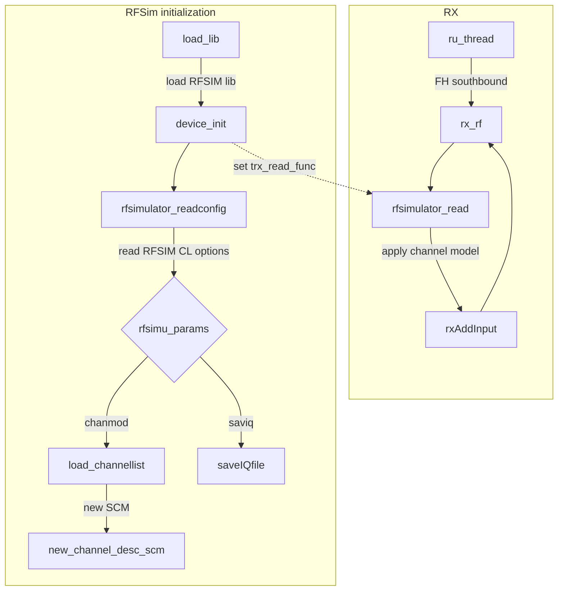

<!-- SPDX-License-Identifier: CC-BY-4.0 -->

[[_TOC_]]

# General

This is an RF simulator that allows to test OAI without an RF board. It
replaces an actual RF board driver. In other words, towards the xNB/UE, it
behaves like a "real" RF board, but it forwards samples between both ends
instead of sending it over the air. It can simulate simple channels, such as
AWGN, hence it *simulates* RF.

As much as possible, it works like an RF board, but not in real-time: It can
run faster than real-time if there is enough CPU, or slower (it is CPU-bound
instead of real-time RF sampling-bound).

# Architecture

High-level flowchart of the RF Simulator, including the channel simulation feature:



# Build

## From [build_oai](../../doc/BUILD.md) script
The RF simulator is implemented as an OAI device and always built when you build the OAI eNB or the OAI UE.

Using the `-w SIMU` option it is possible to just re-build the RF simulator device.

Example:
```bash
./build_oai --UE --eNB --gNB --nrUE --ninja -w SIMU
```

## Add the rfsimulator after initial build

After any regular build you can compile the device from the build directory:
```bash
cd <path to oai sources>/openairinterface5g/cmake_targets/ran_build/build
ninja rfsimulator
```

This is equivalent to using `-w SIMU` when running the `build_oai` script.

# Usage

## Overview

To use the RF simulator add the `--rfsim` option to the command line. By
default the RF simulator device will try to connect to host 127.0.0.1, port
4043, which is usually the behavior for the UE.  For the eNB/gNB, you either
have to pass `--rfsimulator.[0].serveraddr server` on the command line, or specify
the corresponding section in the configuration file.

The RF simulator is using the configuration module, and its parameters are defined in a specific section called "rfsimulator". Add the following options to the command line in order to enable different RFSim features:

| CL option                            | usage                                                                          | default                |
|:-------------------------------------|:-------------------------------------------------------------------------------|----:                   |
|`--rfsimulator.[0].serveraddr <addr>` | IPv4v6 address or DNS name to connect to, or `server` to behave as a IPv4v6 TCP server | 127.0.0.1      |
|`--rfsimulator.[0].serverport <port>` | port number to connect to or to listen on (eNB, which behaves as a tcp server) | 4043                   |
|`--rfsimulator.[0].options`           | list of comma separated run-time options, two are supported: `chanmod`, `saviq`| all options disabled   |
|`--rfsimulator.[0].options saviq`     | store IQs to a file for future replay                                          | disabled               |
|`--rfsimulator.[0].options chanmod`   | enable the channel model                                                       | disabled               |
|`--rfsimulator.[0].IQfile <file>`     | path to a file to store the IQ samples to (only with `saviq`)                  | `/tmp/rfsimulator.iqs` |
|`--rfsimulator.[0].ploss`             | coupling loss in dB (positive = attenuation, negative = net gain) of the model created by `rfsimu setmodel` | 0 |
|`--rfsimulator.[0].prop_delay`        | simulated receive-path (gNB: UL, UE: DL) propagation delay in ms               | 0                      |
|`--rfsimulator.[0].wait_timeout`      | wait timeout when no UE is connected                                           | 1                      |

Please refer to this document [`SIMULATION/TOOLS/DOC/channel_simulation.md`](../../openair1/SIMULATION/TOOLS/DOC/channel_simulation.md) for information about using the RFSimulator options to run the simulator with a channel model.

## 4G case

For the eNB, use a valid configuration file setup for the USRP board tests and start the softmodem with the `--rfsim` and `--rfsimulator.[0].serveraddr server` options.
```bash
sudo ./lte-softmodem -O <config file> --rfsim --rfsimulator.[0].serveraddr server
```
Often, configuration files define the corresponding `rfsimulator` section, in
which case you might omit `--rfsimulator.[0].serveraddr server`. Example:
```
rfsimulator = (
  {
    serveraddr = "server";
  }
);
```

For the UE, it should be set to the IP address of the eNB. For instance, if the
eNB runs on another host with IP `192.168.2.200`, do
```bash
sudo ./lte-uesoftmodem -C 2685000000 -r 50 --rfsim --rfsimulator.[0].serveraddr 192.168.2.200
```
For running on the same host, only `--rfsim` is necessary.

The UE and the eNB can be used as if the RF is real. The noS1 mode might be used as well with the RF simulator.

If you reach 'RA not active' on UE, be careful to generate a valid SIM.
```bash
$OPENAIR_DIR/cmake_targets/ran_build/build/conf2uedata -c $OPENAIR_DIR/openair3/NAS/TOOLS/ue_eurecom_test_sfr.conf -o .
```

## 5G case

Similarly as for 4G, first launch the gNB, here in an example for the phytest:

run gNB:

  ```bash
  sudo ./nr-softmodem -O ../../../targets/PROJECTS/GENERIC-LTE-EPC/CONF/gnb.band78.tm1.106PRB.usrpn300.conf --gNBs.[0].min_rxtxtime 6 --phy-test --rfsim --rfsimulator.[0].serveraddr server
  ```

where `--gNBs.[0].min_rxtxtime 6` is due to the UE not being able to handle shorter
RX/TX times.  As in the 4G case above, you can define an `rfsimulator` section
in the config file.

and run UE:

  ```bash
  sudo ./nr-uesoftmodem --rfsim --phy-test --rfsimulator.[0].serveraddr <TARGET_GNB_IP_ADDRESS>
  ```

To run OAI RFSimulator for SA mode, gNB:

  ```bash
  sudo ./nr-softmodem -O ../../../targets/PROJECTS/GENERIC-NR-5GC/CONF/gnb.sa.band78.fr1.106PRB.usrpb210.conf --rfsim --rfsimulator.[0].serveraddr server
  ```

and UE:

  ```bash
  sudo ./nr-uesoftmodem --rfsim --rfsimulator.[0].serveraddr <TARGET_GNB_IP_ADDRESS>
  ```

In the commands for the UE, `TARGET_GNB_IP_ADDRESS` can be 127.0.0.1 if both UE and gNB run on the same machine.

If necessary the user can provide a custom UICC configuration file to the UE with command line option `-O ue.conf`. In case of a multi-UE scenario, the user shall provide a different IMSI to each UE with the command line option `--uicc0.imsi` followed by the IMSI, e.g. `--uicc0.imsi 001010000000001`.

Notes:

1. This starts the gNB and UE in the `phy-test` UP-only mode where the gNB is started as if a UE had already connected. See [`RUNMODEM.md`](../../doc/RUNMODEM.md) for more details.
2. `<TARGET_GNB_IP_ADDRESS>` should be the IP interface address of the remote host running the gNB executable, if the gNB and nrUE run on separate hosts, or be omitted if they are on the same host.
3. To enable the noS1 mode, `--noS1` option should be added to the command line, see again [`RUNMODEM.md`](../../doc/RUNMODEM.md).
4. Information on operating the gNB/UE with a 5GC can be found here. [here](../../doc/NR_SA_Tutorial_OAI_CN5G.md).

## Store and replay

You can store emitted I/Q samples. If you set the option `saviq`, the simulator will write all the I/Q samples into this file. Then, you can replay with the executable `replay_node`.

First compile it like other binaries:
```bash
make replay_node
```
You can use this binary as I/Q data source to feed whatever UE or gNB with recorded I/Q samples.

The file format is successive blocks of a header followed by the I/Q array. If you have existing stored I/Q, you can adapt the tool `replay_node` to convert your format to the rfsimulator format.

The format intends to be compatible with the OAI store/replay feature on USRP.

## How to use OAI RFSIM with a channel model

Please refer to this document [`channel_simulation.md`](../../openair1/SIMULATION/TOOLS/DOC/channel_simulation.md) to get familiar with channel simulation in RFSIM and to see the list of commands for real-time usage with telnet.

## How to simulate a simple GEO satellite channel model

A simple channel model for satellites on a geostationary orbit (GEO) simulates simply one line-of-sight propagation channel.

The most basic version is to simply simulate a constant propagation delay, without any other effects.

In case of a transparent GEO satellite, the minumum one-way propagation delay (DL: gNB -> satellite -> UE, or UL: UE -> satellite -> gNB) is 238.74 ms.

So, additionally to other parameters, this parameter should be given when executing the gNB and the UE executables:

```
--rfsimulator.[0].prop_delay 238.74
```

Note:

To successfully establish a connection with such a GEO satellite channel, both gNB and UE need to have the NTN support configured.

# Caveats

There are issues in power control: txgain/rxgain setting is not supported.

# How to improve performance

Most importantly, note that the RFsimulator is not designed to be as performant
as possible, nor is it designed to run close to real-time. It might run faster
or slower than realtime, depending on CPU, and by design, as this allows to
stop the entire system for inspection, e.g., using a debugger.

In order to improve performance, you can modify the radio parameters of the gNB
to reduce the amount of transported samples:

- Use option `-E` for three-quarter sampling (also to be done on the UE-side!)
- Prefer smaller cell bandwidths

A possible, unimplemented optimization would be to compress samples.

You can further [tune your machine](../../doc/tuning_and_security.md)

# Beam simulation

RFsimulator supports beam domain simulation. Each antenna element (`nb_tx`/`nb_rx`) carries exactly one
beam ID at a time — not a set of concurrent beams. Different antennas may be assigned the same beam ID
(e.g. to form a wider physical beam out of several antennas), but a single antenna cannot carry more than
one beam ID simultaneously. The beam vector sent alongside the samples therefore always has one entry per
antenna, and there is no separate "concurrent beam count" to configure.

Only the gNB side has a real, switchable beam — a physical property of its antenna array and the
channel. The UE does not switch beams; it simply sits at a fixed position relative to the gNB's beam
space, so the loss it experiences depends only on which of the gNB's beams is currently active.

## Configuration

Command line parameters to be set on gNB side only.

* `--rfsimulator.[0].enable_beams` : enable beam domain simulation
* `--rfsimulator.[0].beam_gains <comma separated list>` : one gain/loss value (in dB) per gNB beam id.
`beam_gains[k]` is the additional gain (negative = loss) applied, on top of the channel model (if present), whenever
the gNB's antenna is on beam `k`.

Example: `0,-2,-3` means the 1st beam is the reference, the 2nd beam has 2 dB extra loss, the 3rd beam has 3 dB extra loss.

All beam gain is applied once, on the gNB side (on Tx for DL, on Rx for UL), using whichever beam the gNB is currently on.
The UE's own samples are never touched: DL arrives already scaled, and UL is scaled by the receiver (the gNB), not the sender.

## Runtime commands

### Changing the beam gains

Use telnet command `rfsimulator setbeamgains <gain1,gain2,...>` to replace the gNB's beam gain table at
runtime, e.g. to script a UE moving through the gNB's beam space over the course of a test without
restarting the simulator.

Shrinking the table below the number of beams actually in use will crash on the next lookup against an
out-of-range beam id; there is no runtime validation against what the gNB is currently sweeping.

## Programming guide

RFsimulator is attempting to simulate hardware device operation, but there are differences. Like with real hardware,
it is expected that you provide the configured beams in the `trx_set_beams` function ahead of sample reception. This
is due to the fact that a hardware device will buffer received samples before the driver requests them.

`trx_set_beams(device, uint16_t *beams, int num_beams, timestamp)` takes a beam ID array whose length (`num_beams`)
must equal the number of antennas (`nb_tx` for TX, `nb_rx` for RX): `beams[a]` is the beam ID to apply on antenna `a`
starting at `timestamp`. As long as the call to `trx_set_beams` with timestamp `n` is done before `trx_read` which is
expected to return sample `n`, the beam switch command will apply to the received samples.
